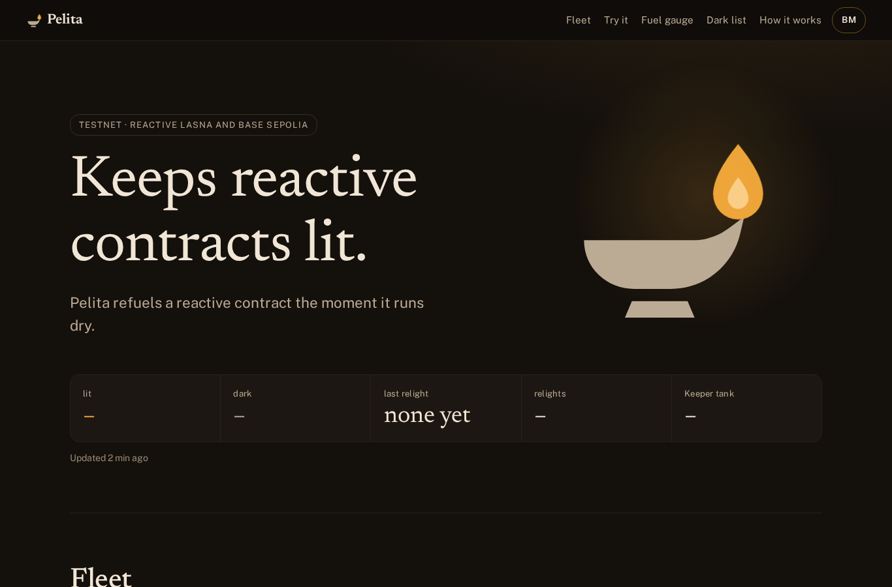
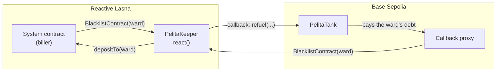

<p align="center"></p>

<h1 align="center">Pelita</h1>

<p align="center"><a href="https://github.com/aimanmalib/pelita/actions/workflows/ci.yml"></a> <a href="LICENSE"></a> </p>

<p align="center"><b>Keeps reactive contracts lit.</b> · <i>Memastikan kontrak reaktif terus menyala.</i><br>
<a href="https://pelita.sasateguh.com">live page</a> · <a href="#verify-without-trusting-this-readme">verify</a> · <a href="docs/measured.md">measured results</a> · <a href="#run-it-your-own-pelita">run your own</a> · <a href="#documentation">documentation</a> · <a href="CHANGELOG.md">changelog</a> · <a href="README.ms.md">Bahasa Melayu</a> · Built in Malaysia by Aiman Malib · Sasa Teguh</p>

<p align="center"></p>

A reactive contract pays for every reaction. When its reserves and balance run out, Reactive Network records a debt,
emits `BlacklistContract`, and stops calling it. There is no alert. The contract stays dark until someone notices, and
every event that arrives in the meantime is lost. The census in this repo counts how often that happens on the testnet.

Pelita is a reactive contract that watches for that exact moment. It subscribes to the system contract's own
`BlacklistContract` log, filtered to the contracts its owner protects, and refuels them from one tank: with `depositTo`
in the same reaction on Lasna, or with a callback to a small tank contract on a destination chain. While nothing goes
dark it does nothing, and nothing is billed. "Pelita" is Malay for an oil lamp.

Built for the **Reactive Omni Buildathon**, Set It and Forget It track. Everything in this repository is built during
the event.

## For judges: the five-minute path

### Execution

- The contracts are [`src/PelitaKeeper.sol`](src/PelitaKeeper.sol) (Lasna) and [`src/PelitaTank.sol`](src/PelitaTank.sol)
  (destination). Their testnet addresses and full-loop transaction hashes are added to this README and to
  `deployments/` as the deployment lands; until then this section names what to check, not a result.
- [`scripts/verify.sh`](scripts/verify.sh) reads every recorded contract back from the chain with plain `cast` calls.
- [docs/measured.md](docs/measured.md) is written by a script from evidence files only. A target that was missed says so.

### Integration

- The Keeper subscribes to the biller's `BlacklistContract` and `WhitelistContract` logs per protected contract
  ([`_subscriptions`](src/PelitaKeeper.sol#L265)) and handles them in [`react()`](src/PelitaKeeper.sol#L157).
- On Lasna it pays the debt with `depositTo` inside the reaction ([`_refuelLocal`](src/PelitaKeeper.sol#L195)).
- On Base Sepolia it emits a callback ([`_requestRefuel`](src/PelitaKeeper.sol#L225)); the Tank accepts it only from the
  callback proxy carrying the Keeper as sender ([`refuel`](src/PelitaTank.sol#L71)).
- Chain facts (system contract, callback proxy, topics, log range caps) were re-read on chain:
  [E-001](docs/evidence/E-001-chain-facts.json), [ADR 0003](docs/decisions/0003-chain-facts-and-fork-tests.md).

### Usefulness

- The [census](#how-often-contracts-go-dark) counts contracts that went dark on Lasna and Base Sepolia, with no key, and
  anyone can repeat it with the command in its row.
- The [live page](https://pelita.sasateguh.com) has a fuel gauge for any Lasna contract and a list of contracts that are
  dark right now. Anyone can relight any of them: `depositTo` needs no permission.
- [`scripts/deploy-your-own.sh`](scripts/deploy-your-own.sh) deploys your own Keeper and Tank with one command.

### Craft

- Unit, invariant and read-only fork tests; CI runs the same offline gate as the local script ([Tests](#tests)).
- `react()` and `refuel()` never revert for an ordinary log, because the network bills a reverted reaction too. Every
  refusal is an event with a reason code ([docs/SECURITY.md](docs/SECURITY.md)).
- Decisions are recorded in [docs/decisions/](docs/decisions/); the page is English and Malay and tested on WebKit
  iPhone 13.

## How it works



1. The owner calls `protect(chainId, contract, refill, maxOwed, dailyCap)`. The Keeper subscribes to the dark log for
   that one address.
2. The contract goes dark. The system contract (on Lasna) or the callback proxy (on a destination) emits
   `BlacklistContract`.
3. The Keeper reacts. It reads the debt, checks the limits, and pays `debt + refill`: directly on Lasna, through the Tank
   on a destination. The network emits `WhitelistContract` and calls the contract again.

Limits per protected contract: at most `maxOwed` of debt per refuel, at most `dailyCap` refuels a day, and a floor the
Keeper and the Tank never spend, so they can still pay for their own reactions after a busy day. Details and the
invariant tests that check them: [docs/SECURITY.md](docs/SECURITY.md).

## Deployment and full loops

The contracts are not deployed to the testnets yet. When they are, this section lists each address with its source
verification link (Sourcify on Lasna, Blockscout on Base Sepolia), and three loops with every transaction hash:

- **Lasna:** the outage transaction (`BlacklistContract`) and the Keeper's reaction (`Refueled` and
  `WhitelistContract` in the same transaction).
- **Base Sepolia:** the outage on the callback proxy, the Keeper's reaction on Lasna (`RefuelRequested`), the `refuel`
  callback on Base Sepolia and the `Relit` event.
- **Demo:** a `Beat` from `Beacon`, the reaction in `Flicker`, and the `Lit` callback in `Lantern`.

## Verify without trusting this README

```sh
git clone --recurse-submodules https://github.com/aimanmalib/pelita && cd pelita
bash scripts/verify.sh
```

It needs only Foundry's `cast` and no key. Every command is printed before it runs, so you can copy it and run it
yourself. It reads the addresses from `deployments/`, checks that each one has code, and reads the
Keeper's protected contracts, limits and fuel.

## Cause an outage yourself

The demo pair is built to run dry. `Beacon` on Base Sepolia emits a beat when anyone pokes it, and `Flicker` on Lasna
pays for a reaction to every beat. It is funded with very little on purpose, so a few beats put it into debt:

```sh
cast send <Beacon> "poke()" --rpc-url https://sepolia.base.org --account <your-keystore>
```

Pokes are limited to one per cooldown and a fixed number a day, both read from the contract. The page shows the
cooldown left and the next steps; the `Beacon` address appears there and in `deployments/` once deployed.

## How often contracts go dark

From [docs/measured.md](docs/measured.md), counted by [`scripts/census.py`](scripts/census.py) since
2026-11-04T04:18:00Z:

| Chain | Outages | Contracts | Still dark |
|---|---|---|---|
| Reactive Lasna | 154 | 116 | 97 |
| Base Sepolia | 21 | 21 | 17 |

The page shows the same census, refreshed every two minutes by [`ops/indexer.py`](ops/indexer.py). The relight times,
the control pair and the cost per relight land in the same file once the series has run on chain.

## What already exists

Reactivate, a 2025 winner, solved this problem for the previous version of Reactive Network with a different design.
Its code is tied to the legacy system contract address. Keeper designs that poll on Cron pay on every tick, so the keeper
itself can run dry. Pelita has no Cron subscription.

| | Pelita | A Cron-based keeper |
|---|---|---|
| Trigger | the system contract's `BlacklistContract` log, per address | a timer |
| Cost while nothing is dark | none | one reaction per tick |
| Destination chains | callback to a tank that pays the proxy | depends on the design |
| Network version | Omni (`reactive-lib-omni` v0.1.0) | — |

## Cost

Each relight costs the protected contract's debt plus the `refill` its owner chose, paid from the tank, plus the
Keeper's own reaction fee. On a destination chain the callback is paid by the Tank. The measured cost per relight, in
`lREACT` and in ETH, will be in [docs/measured.md](docs/measured.md) with the hash of every transaction behind it.

## Limits

- Testnet only (Reactive Lasna and Base Sepolia). Not audited. Do not use it with real money.
- One owner per deployment. The tank is the Keeper's and the Tank's own balance; nothing is borrowed.
- Events that arrive while a contract is dark are lost. Pelita makes that window short, not zero.
- If the tank is empty, the Keeper gives up with a reason code and the contract stays dark until someone refuels it.
- A refuel that needs more than `maxOwed`, or more than `dailyCap` refuels in a day, is refused on purpose.

## Run it: your own Pelita

You need [Foundry](https://getfoundry.sh), a Foundry keystore (`cast wallet new`), and test coins on Base Sepolia and
Lasna.

```sh
git clone --recurse-submodules https://github.com/aimanmalib/pelita && cd pelita
bash scripts/deploy-your-own.sh <keystore-name>
```

It deploys a Keeper on Lasna and a Tank on Base Sepolia and writes their addresses to `deployments/own/`. Fund the tank
with a plain transfer: send test coins to the Keeper or the Tank address. Then protect a contract you own (amounts in
wei):

```sh
cast send <keeper> "protect(uint256,address,uint256,uint256,uint32)" 5318007 <your-contract> \
  50000000000000000 100000000000000000 10 --account <keystore-name> --rpc-url https://lasna-rpc.rnk.dev/
```

## Tests

```sh
bash scripts/gerbang-ujian.sh      # format, build, Solidity tests, Python tests, README links; offline, same as CI
bash scripts/spike/fork-tests.sh   # read-only tests against live Lasna and Base Sepolia state
```

The Solidity tests run the Keeper against a mock system contract placed at the real address, cover every refusal
reason, and include invariant tests for the spending limits. The Python tests run the census and the indexer on
recorded chain replies, and the deploy script twice against two local anvil chains with the real chain ids. Fork test
runs are recorded in [docs/test-results.md](docs/test-results.md).

## How AI was used

I directed an AI coding agent through the whole build: it wrote the contracts, tests, scripts, page and this README, and
I chose the design and checked the results. The numbers in this README come from scripts that read the chain, not from
the agent.

## AI disclosure

I built Pelita with Claude Code: the contracts, tests, scripts, page and this README were written with an AI coding
agent that I directed. The chain measurements are produced by scripts in this repo and can be re-run by anyone.

## Documentation

| File | What it holds |
|---|---|
| [docs/measured.md](docs/measured.md) | Measured results, written from evidence files |
| [docs/SECURITY.md](docs/SECURITY.md) | Who may call what, spending limits, why nothing reverts |
| [docs/decisions/](docs/decisions/) | Architecture decision records |
| [docs/test-results.md](docs/test-results.md) | Fork test runs and chain fact checks |
| [docs/build-log.md](docs/build-log.md) | One line per day of work |
| [CONTRIBUTING.md](CONTRIBUTING.md) | Setting up and testing a change |
| [SECURITY.md](SECURITY.md) | Reporting a vulnerability |

## License

MIT, see [LICENSE](LICENSE).
