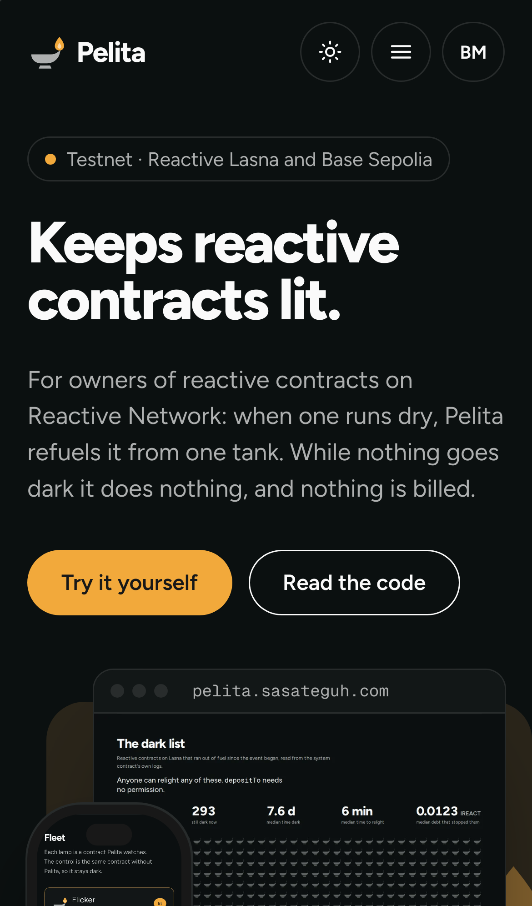

<p align="center"></p>

<h1 align="center">Pelita</h1>

<p align="center"><a href="https://github.com/aimanmalib/pelita/actions/workflows/ci.yml"></a> <a href="LICENSE"></a> </p>

<p align="center"><b>Memastikan kontrak reaktif terus menyala.</b> · <i>Keeps reactive contracts lit.</i><br>
<a href="https://pelita.sasateguh.com">laman langsung</a> · <a href="docs/measured.md">hasil diukur</a> · <a href="README.md">English</a> · Dibina di Malaysia oleh Aiman Malib · Sasa Teguh</p>

<p align="center"></p>

Kontrak reaktif membayar setiap reaksi. Bila rizab dan bakinya habis, Reactive Network mencatat hutang, memancarkan
`BlacklistContract`, dan berhenti memanggilnya. Tiada amaran. Kontrak itu kekal padam sehingga seseorang perasan, dan
setiap peristiwa yang tiba dalam tempoh itu hilang.

Pelita ialah kontrak reaktif yang menunggu saat itu. Ia melanggan log `BlacklistContract` kontrak sistem sendiri, hanya
untuk kontrak yang dijaga pemiliknya, dan mengisi semula kontrak itu dari satu tangki: dengan `depositTo` dalam reaksi
yang sama di Lasna, atau dengan callback kepada kontrak tangki kecil di rantaian destinasi. Selagi tiada apa-apa padam,
ia tidak berbuat apa-apa dan tidak dibil.

Dibina untuk **Reactive Omni Buildathon**, trek Set It and Forget It, sepanjang tempoh acara.

## Hasil diukur

Dari [docs/measured.md](docs/measured.md), ditulis skrip daripada bacaan rantaian. Masa ikut cap masa blok.

| | Sasaran | Diukur |
|---|---|---|
| H1. Lasna: padam `Flicker` dijaga dinyalakan semula oleh Keeper | sekurang-kurangnya 30, 100%, median paling lama 5 s | 52 daripada 52, median 1 s |
| H2. Base Sepolia: padam `Lantern` dijaga dinyalakan melalui callback | sekurang-kurangnya 15, 100%, median paling lama 10 s | 17 daripada 17, median 1 s |
| H3. `Flicker` kawalan di Lasna, tanpa Pelita | padam sekurang-kurangnya 24 j, `debt()` melebihi 0 | padam 32.1 j, `debt()` 0.0131257 `lREACT` |
| H5. Yuran reaksi Keeper (median) | | 0.017684 `lREACT` (Lasna); 0.0150344 `lREACT` + callback 0.000000695094 ETH (Base Sepolia) |

Alamat kontrak dan hash setiap transaksi gelung pertama: [README.md](README.md#deployment-and-full-loops).

## Berapa kerap kontrak padam

Dari [docs/measured.md](docs/measured.md), dikira oleh [`scripts/census.py`](scripts/census.py) sejak
2026-11-04T04:18:00Z:

| Rantaian | Dikira hingga | Padam | Kontrak | Masih padam |
|---|---|---|---|---|
| Reactive Lasna | 2026-11-27 | 570 | 369 | 277 |
| Base Sepolia | 2026-11-16 | 21 | 21 | 17 |

Kiraan ini termasuk kontrak demo dan kawalan saya sendiri. Kiraan Base Sepolia berhenti lebih awal kerana julat
panjangnya dibaca melalui API Blockscout, yang menolak hos ini pada 2026-11-27. Video demo memetik banci Lasna hingga
2026-11-16 (116 kontrak, 97 masih padam); setiap banci ada dalam measured.md.

## Cara menjalankan

```sh
git clone --recurse-submodules https://github.com/aimanmalib/pelita && cd pelita
bash scripts/verify.sh                       # semak kontrak di rantaian, tanpa kunci
bash scripts/deploy-your-own.sh <nama-stor>  # pasang Keeper dan Tank anda sendiri
```

Isi tangki dengan pemindahan biasa ke alamat Keeper atau Tank. Arahan penuh dalam [README.md](README.md#run-it-your-own-pelita).

## Ujian

`bash scripts/gerbang-ujian.sh` menjalankan format, binaan, ujian Solidity, ujian Python dan semakan pautan README, sama
seperti CI. Ujian fork baca-sahaja: `bash scripts/spike/fork-tests.sh`.

## Had

- Testnet sahaja (Reactive Lasna dan Base Sepolia). Belum diaudit. Jangan guna dengan wang sebenar.
- Satu pemilik bagi setiap pemasangan. Peristiwa yang tiba semasa kontrak padam tetap hilang; Pelita memendekkan tempoh
  itu, bukan menghapuskannya.
- Tangki kosong = Keeper berhenti dengan kod sebab, dan kontrak kekal padam sehingga diisi semula.

## Pengisytiharan AI

Saya membina Pelita dengan Claude Code: kontrak, ujian, skrip, laman dan README ini ditulis oleh ejen pengekodan AI yang
saya arahkan. Ukuran rantaian dihasilkan oleh skrip dalam repo ini dan boleh diulang oleh sesiapa sahaja.

## Lesen

MIT, lihat [LICENSE](LICENSE).
